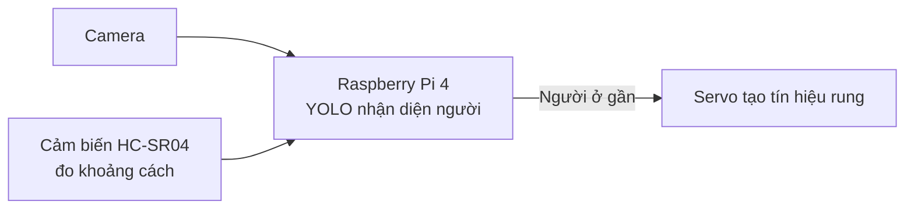

# SafeStep — Smart Mobility Assistant

**Project description:** A Raspberry Pi 4 assistive mobility prototype combining camera-based person detection, ultrasonic distance sensing, and servo-driven haptic alerts.

> **Trạng thái:** repository hiện có script tải dữ liệu và fine-tune model YOLO. Phần chương trình chạy camera, cảm biến và servo trên Raspberry Pi chưa được tích hợp; sơ đồ chân bên dưới là thiết kế phần cứng tham khảo.

## Chức năng dự kiến

- Nhận diện người trong hình ảnh từ camera.
- Đo khoảng cách tới vật cản ở phía trước bằng cảm biến siêu âm.
- Khi phát hiện người và khoảng cách nhỏ hơn ngưỡng cài đặt, điều khiển servo chuyển động để tạo cảnh báo xúc giác.
- Cho phép fine-tune YOLO với dataset nhận diện người riêng.

### Luồng hoạt động



Cảm biến siêu âm chỉ đo vật cản gần nhất trong vùng hướng của nó; cảm biến không biết vật đó có phải đúng người mà camera nhận diện hay không. Để số đo gần với khoảng cách từ camera đến vật, hãy đặt camera và cảm biến sát nhau, cùng hướng. Khi có nhiều vật thể hoặc hướng cảm biến lệch khỏi camera, khoảng cách đo được có thể thuộc về vật khác.

## Phần cứng

- Raspberry Pi 4
- Camera Raspberry Pi tương thích CSI hoặc webcam USB
- Cảm biến khoảng cách HC-SR04
- Servo micro (ví dụ SG90) để tạo chuyển động cảnh báo
- Nguồn 5 V riêng cho servo, dây nối và điện trở chia áp cho chân Echo

> **Lưu ý điện áp:** GPIO của Raspberry Pi dùng mức 3,3 V và không chịu được tín hiệu Echo 5 V trực tiếp. Dùng mạch chia áp trước khi nối Echo vào Pi. Cấp nguồn servo từ nguồn 5 V riêng, nối chung GND với Raspberry Pi; không cấp servo trực tiếp từ chân 3,3 V của Pi.

### Sơ đồ chân tham khảo (BCM)

| Thiết bị | Chân thiết bị | Raspberry Pi 4 |
|---|---|---|
| HC-SR04 | VCC | 5 V |
| HC-SR04 | GND | GND |
| HC-SR04 | TRIG | GPIO23 |
| HC-SR04 | ECHO | GPIO24 qua mạch chia áp 5 V xuống 3,3 V |
| Servo | Signal | GPIO18 |
| Servo | VCC | Nguồn 5 V riêng |
| Servo | GND | GND chung với Raspberry Pi |
| Camera CSI | Cáp CSI | Cổng camera CSI |

Chân GPIO trong bảng chỉ là cấu hình gợi ý; cần dùng đúng số chân trong chương trình khi phần điều khiển phần cứng được bổ sung. Nếu mục tiêu là rung trực tiếp trên tay, động cơ rung có driver thường phù hợp hơn servo; servo cần một cơ cấu gắn vào để truyền rung/chuyển động.

## Model nhận diện

Dự án dùng Ultralytics YOLO26n làm model khởi tạo và fine-tune với dataset nhận diện người. Checkpoint sau khi train được lưu tại:

```text
runs/detect/person-custom/weights/best.pt
```

File model `.pt`, dữ liệu trong `data/` và kết quả trong `runs/` được loại khỏi Git theo `.gitignore`. Vì vậy, clone repository mới sẽ không có các file này. Có thể train lại theo hướng dẫn bên dưới hoặc phân phối checkpoint riêng, kèm thông tin nguồn dữ liệu và giấy phép sử dụng.

## Cài đặt và train model

Phần huấn luyện hiện được hướng dẫn trên Windows. Mở PowerShell trong thư mục repository:

```powershell
py -m venv .venv
.\.venv\Scripts\Activate.ps1
python -m pip install --upgrade pip
pip install -r requirements.txt
Copy-Item .env.example .env
```

Điền `ROBOFLOW_API_KEY` vào file `.env` để tải dataset từ Roboflow. Không commit hoặc chia sẻ file `.env`.

Bắt đầu tải dữ liệu và train:

```powershell
python train.py
```

Một số tuỳ chọn:

```powershell
python train.py --download-only
python train.py --epochs 50 --imgsz 640 --batch 8
python train.py --device cpu
python train.py --redownload
```

Model khởi tạo mặc định là `yolo26n.pt`. Có thể chọn bản lớn hơn, ví dụ `--model yolo26s.pt`, nếu máy có đủ tài nguyên.

## Cấu trúc repository

```text
.
├── train.py          # Tải dataset và fine-tune YOLO
├── requirements.txt  # Thư viện Python
├── .env.example      # Mẫu cấu hình API key Roboflow
├── yolo26n.pt        # Checkpoint khởi tạo (bị Git bỏ qua)
├── data/             # Dataset (bị Git bỏ qua)
└── runs/             # Checkpoint và kết quả train (bị Git bỏ qua)
```

## Giới hạn hiện tại

- Code trong repository hiện tập trung vào huấn luyện model trên máy tính; chưa có script inference thời gian thực cho camera Raspberry Pi.
- Chưa có module đọc HC-SR04, điều khiển servo hoặc ghép kết quả cảm biến với kết quả nhận diện.
- HC-SR04 đo khoảng cách tới bề mặt gần nhất trong vùng quét, không xác định danh tính vật thể.
- Độ chính xác nhận diện phụ thuộc dataset, ánh sáng, góc camera và phần cứng chạy model.

## Hướng phát triển

- Thêm chương trình inference camera trên Raspberry Pi 4.
- Thêm module đọc khoảng cách HC-SR04 có xử lý timeout và lọc nhiễu.
- Thêm điều khiển servo theo các ngưỡng khoảng cách có thể cấu hình.
- Đánh giá tốc độ và độ chính xác trên Raspberry Pi 4; cân nhắc xuất model sang định dạng phù hợp nếu cần.

## Giấy phép

Chưa khai báo giấy phép cho repository. Hãy bổ sung `LICENSE` trước khi phát hành công khai và kiểm tra điều khoản của thư viện, checkpoint và dataset được sử dụng.

